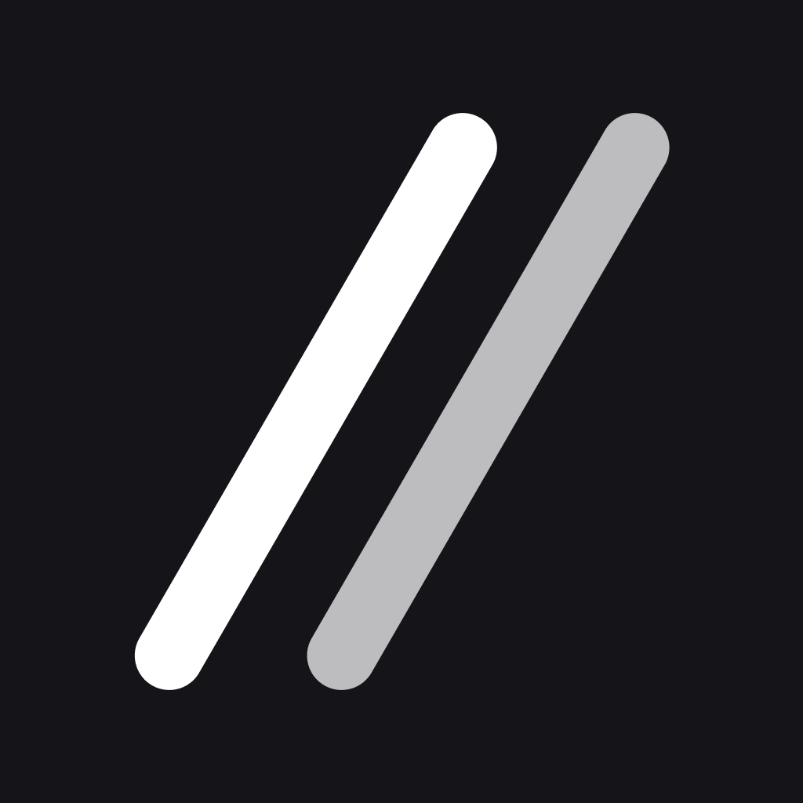

<p align="center">
  
</p>

<h1 align="center">Pair</h1>

<p align="center">
  Publish a pull request together with the agent sessions that built it, and get an AI review of how it was made.
  <br>
  For <a href="https://claude.com/product/claude-code">Claude Code</a> and <a href="https://developers.openai.com/codex">Codex</a>.
</p>

<p align="center">
  <a href="#install">Install</a> ·
  <a href="#custom-marketplaces">Custom marketplaces</a> ·
  <a href="#usage">Usage</a> ·
  <a href="#what-it-runs-fetches-and-sends">Privacy</a> ·
  <a href="#troubleshooting">Troubleshooting</a>
</p>

---

A diff shows what changed. It doesn't show how the change came to be. Pair captures that
missing context: it publishes a pull request's evidence, including **redacted transcripts of the
coding-agent sessions that built it**, to [pair.sh](https://pair.sh), where an AI review is generated
server-side.

This repository contains the plugin and [Pair CLI source](cli/). The plugin is deliberately thin at
runtime: it installs the Pair CLI (`paircli`) on your machine and gets out of the way. Scanning,
redaction, publishing and PR detection all live in the CLI.

## One repository, same runtime

- `hooks/`, `skills/` and the plugin manifests integrate with the agent harness.
- `cli/` owns the Go command, scanning, redaction, publishing, hooks, updater,
  notification helper and their tests. Its module is `github.com/interviewstreet/pair-plugin/cli`.
- `.github/workflows/` tests both parts and builds CLI releases from `cli/`.

Users still download a precompiled platform binary on first setup. Existing
installations migrate once to this repository's release source; later CLI
updates use the same source. Users do not need Go or a source build. Creating a
PR or pushing a commit continues to run the installed CLI, not recompile it or
download it on every push. Session-start setup checks for updates as before.

## Install

There are two ways to install Pair. Both set up the same CLI, so you can use either one, or both on the same
machine. macOS and Linux only; on Windows, use WSL.

### One command (Claude Code and Codex)

```sh
curl -fsSL https://github.com/interviewstreet/pair-plugin/releases/latest/download/install.sh | sh
```

The installer prints what it will set up, then:

1. installs `paircli` in `~/.paircli/bin` (nothing is added to your `PATH`);
2. installs the PR hooks in every agent it finds (Claude Code, Codex) and approves them in Codex for you, so
   there is no `/hooks` step;
3. opens the Pair login in your browser. Click **Approve**.

It needs `curl`, not `python3`. [`gh`](https://cli.github.com) must be installed and signed in; if it isn't,
the installer sets up everything else and tells you the one step left. Run the command again at any time:
it only changes what is missing.

To check the script before running it:

```sh
curl -fsSLO https://github.com/interviewstreet/pair-plugin/releases/latest/download/install.sh
gh attestation verify install.sh -R interviewstreet/pair-plugin
sh install.sh
```

On a machine without a browser, or from a script, add `--no-login` (`sh -s -- --no-login`) and run
`~/.paircli/bin/paircli login` later. To roll Pair out to managed machines (MDM, managed settings), see
[docs/ORG_ROLLOUT.md](docs/ORG_ROLLOUT.md).

### Plugin: Claude Code

In a session (Claude Code 2.1.275 or later):

```text
/plugin install pair --marketplace interviewstreet/pair-plugin
```

Or from your shell, in one command (Claude Code 2.1.292 or later):

```sh
claude plugin install pair --marketplace interviewstreet/pair-plugin
```

Or in two steps, on any version:

```sh
claude plugin marketplace add interviewstreet/pair-plugin
claude plugin install pair@pair
```

Then start a new session. The plugin's session-start hook sets everything up.

### Plugin: Codex

```sh
codex plugin marketplace add interviewstreet/pair-plugin
codex plugin add pair@pair
```

Start a new session and review the hook when Codex asks. Codex skips plugin hooks until you trust them.
Pair is installed from this repository rather than from Codex's public directory.

### What happens on first run

The first session after install shows a one-line status, and setup finishes in the background:

1. Pair CLI is downloaded to `~/.paircli/bin/paircli` if it's missing or needs the one-time migration to this repository's release source.
2. `paircli setup` installs the PR hook for your agent and opens a **device login** in your browser.
3. Approve the login on pair.sh. Nothing is uploaded before you do.

| Status line | Meaning |
| --- | --- |
| `Pair setup started: installing the Pair CLI, then approve the login in your browser; …` | First session. Setup is running in the background. |
| `Pair CLI <version>: login pending, hook installed. To finish, approve the login in your browser; …` | Approve the login on pair.sh. The device code and URL are in `~/.paircli/logs/setup-*.log`. |
| `Pair CLI <version>: logged in, hook installed` | Ready. Nothing to do. |

## Custom marketplaces

Install Pair from your own marketplace to pin a version, mirror it, or roll it out to a team.

### Claude Code

Add Pair as an entry in your marketplace's `.claude-plugin/marketplace.json`:

```json
{
  "name": "acme-tools",
  "owner": { "name": "Acme" },
  "plugins": [
    {
      "name": "pair",
      "source": {
        "source": "git-subdir",
        "url": "https://github.com/interviewstreet/pair-plugin.git",
        "path": "plugins/pair",
        "ref": "main"
      }
    }
  ]
}
```

Pin to an exact commit by adding `"sha": "<40-character commit sha>"`. Users then install it with:

```sh
claude plugin marketplace add your-org/your-marketplace
claude plugin install pair@acme-tools
```

To give every teammate the marketplace and the plugin without a manual step, commit this to the project's
`.claude/settings.json`:

```json
{
  "extraKnownMarketplaces": {
    "acme-tools": {
      "source": { "source": "github", "repo": "your-org/your-marketplace" }
    }
  },
  "enabledPlugins": { "pair@acme-tools": true }
}
```

### Codex

Add Pair to your marketplace's `.agents/plugins/marketplace.json`:

```json
{
  "name": "acme-tools",
  "interface": { "displayName": "Acme Tools" },
  "plugins": [
    {
      "name": "pair",
      "source": {
        "source": "git-subdir",
        "url": "https://github.com/interviewstreet/pair-plugin.git",
        "path": "./plugins/pair",
        "ref": "main"
      },
      "policy": { "installation": "AVAILABLE", "authentication": "ON_INSTALL" },
      "category": "Productivity"
    }
  ]
}
```

Users then run:

```sh
codex plugin marketplace add your-org/your-marketplace
codex plugin add pair@acme-tools
```

Git-backed entries can use `ref` or `sha` to pin a version.

### From a local checkout

```sh
git clone https://github.com/interviewstreet/pair-plugin.git
claude --plugin-dir ./pair-plugin/plugins/pair          # Claude Code, for one session
claude plugin marketplace add ./pair-plugin             # Claude Code, installed
codex plugin marketplace add ./pair-plugin              # Codex
```

## Usage

Most of the time you don't do anything. After setup, when your agent runs a successful `gh pr create`,
or a `git push` on a branch that has an open PR, the Pair hook publishes the PR in the background and
prints the review link:

```text
https://pair.sh/<owner>/<repo>/pull/<n>
```

To publish by hand, use the `/pair` skill with a PR reference, URL or number:

```text
/pair owner/repo#123
/pair https://github.com/owner/repo/pull/123
/pair 123
```

The AI review is generated on the server after the upload, so the page fills in a few minutes later.

> **Publishing needs GitHub access.** After you sign in on pair.sh, the Pair GitHub App must be authorized
> for the repository. Pair asks for that on the PR's page; if `paircli publish` is refused for lack of it,
> it prints the link.

## What it runs, fetches and sends

Nothing here is hidden. This is everything the plugin does:

- **Downloads.** The release manifest
  (`https://github.com/interviewstreet/pair-plugin/releases/latest/download/latest.json`) and the `paircli`
  binary it names, for your OS and CPU, over https with `curl`. The binary's SHA-256 is checked against the
  manifest before it is installed in `~/.paircli/bin`. This happens when the binary is missing or needs
  the one-time release-source migration. Subsequent CLI updates use the same repository's releases.
- **Runs.** At session start the hook starts one detached background process. It installs the binary if
  needed and runs `paircli setup`, which installs a PR hook for your agent (a change to your agent's hook
  configuration) and starts a device login in your browser. The hook itself finishes in seconds and never
  blocks your session. Nothing is uploaded until you approve that login on pair.sh.
- **Uploads.** After login, when your agent creates a PR or pushes to a PR branch, `paircli` uploads the PR
  scan and the new part of the agent session transcripts to pair.sh. Transcripts can contain your prompts and
  the agent's output. Secrets are redacted **on your machine** before anything is written to the upload.
  Redaction is best effort; don't rely on it for secrets you wouldn't want Pair to hold.

[docs/ONBOARDING.md](docs/ONBOARDING.md) lists exactly which files are uploaded and which token formats are redacted.

## Requirements

- macOS or Linux on arm64 or amd64. Windows is not supported; on Windows, use WSL.
- `curl` downloads the CLI; it's only needed until the CLI is installed. With the plugin, `python3` runs the
  session-start hook; the one-command installer doesn't need it.
- [`gh`](https://cli.github.com), signed in with `gh auth login`, is what Pair uses to read and comment on PRs.
  Without it, setup still runs, and the status line tells you what's missing.

## Troubleshooting

| Symptom | Fix |
| --- | --- |
| No status line appears | Start a **new** session. The hook runs at session start, not at install. In Codex, make sure you trusted the hook. |
| `Pair setup did not start: curl not found` | Install `curl`, then start a new session. |
| `Note: gh not found` | Install the GitHub CLI and run `gh auth login`. |
| `login pending` and no browser tab opened | Open the URL from the newest `~/.paircli/logs/setup-*.log` and check the device code matches. |
| Check current state | `~/.paircli/bin/paircli status` (add `--json` for scripts). |
| Setup failed | Fix the reported cause and run `~/.paircli/bin/paircli setup`, or start a new session. |

Logs live in `~/.paircli/logs/`. More detail is in [docs/ONBOARDING.md](docs/ONBOARDING.md).

## Update

```sh
claude plugin marketplace update pair && claude plugin update pair@pair   # Claude Code
codex plugin marketplace upgrade                                          # Codex
```

The CLI also checks for a newer `paircli` each time setup runs. If you installed with the one command, the
CLI updates itself: at most once a day, a session start runs `paircli maintain` in the background, which
updates the CLI, adds hooks for agents you installed since, and repairs removed ones.

## Uninstall

If you have the plugin, uninstall it **first**; otherwise its session-start hook installs Pair again:

```sh
claude plugin uninstall pair@pair       # Claude Code
codex plugin remove pair@pair           # Codex
```

Then remove Pair:

```sh
~/.paircli/bin/paircli uninstall
```

It removes the PR hooks from every agent, the hook approvals Pair added in Codex, the stored credential and
`~/.paircli`. To keep using Pair without the plugin, uninstall only the plugin; the CLI's hooks keep working.

The manual sequence still works too. Remove the CLI pieces first, because the binary is needed for the first
two commands:

```sh
~/.paircli/bin/paircli hook uninstall   # remove the PR hooks from every harness
~/.paircli/bin/paircli logout           # delete the stored credential
rm -rf ~/.paircli                       # binary, logs and state
```

Then remove the plugin as above.

## Using both

The plugin and the one-command installer share the same binary, login, state and hooks. Running both is
fine: there is still one Pair hook per event, and one upload per push. The CLI owns the PR hooks on either
path; the plugin only adds its session-start hook, which installs or updates the CLI.

## How it works

```text
 session starts
      │
      ▼
 hooks/bootstrap.py ──► prints one status line, then returns (never blocks)
      │ detached background process
      ▼
 ~/.paircli/bin/paircli  ◄── downloaded and SHA-256 checked if missing or migrating
      │ setup (idempotent): self-update · install PR hook · device login
      ▼
 you run `gh pr create` / `git push`  ──►  paircli publish  ──►  pair.sh review
```

## Repository layout

```text
.claude-plugin/        Claude Code marketplace
.agents/plugins/       Codex marketplace
plugins/pair/          installable plugin: manifests, startup hook, skill, icon and docs
cli/                   Pair CLI Go source, runtime, tests and release scripts
install.sh             one-command installer, published with each release
mdm/                   MDM install scripts and managed-hook templates (docs/ORG_ROLLOUT.md)
docs/ONBOARDING.md     setup, upload contents and uninstall in detail
tests/                 hook tests
```

## Development

```sh
uv sync --group dev
uv run pytest
claude plugin validate .
claude plugin validate ./plugins/pair --profile directory
claude --plugin-dir ./plugins/pair
cd cli
go test ./...
go test -race ./internal/notify ./cmd/paircli
go vet ./...
go build ./cmd/paircli
```

## Releases

`v*` tags in this repository are CLI releases. The root release workflow tests
the plugin and CLI, builds macOS/Linux binaries for arm64/amd64, verifies their
checksums and download URLs, attests them, and publishes `latest.json`,
`SHA256SUMS`, `install.sh` and the four binaries to this repository's GitHub Release.
CLI versions are independent of the plugin manifest version.

See [the migration and rollout checklist](docs/CLI_MIGRATION.md) before enabling
this plugin version. Anonymous installs require public release assets. A source
move alone does not make a private repository's binaries publicly downloadable.

The plugin version lives in four places that must agree: `plugins/pair/.claude-plugin/plugin.json`,
`plugins/pair/.codex-plugin/plugin.json`, `PLUGIN_VERSION` in `plugins/pair/hooks/bootstrap.py`, and `pyproject.toml`.
A test enforces it.

For Anthropic Directory submission, select the plugin subfolder `plugins/pair`, not the repository root. This keeps CLI source, test fixtures and development-only assets out of the installed plugin while retaining them in this repository for review and releases. See [the submission checklist](docs/DIRECTORY_SUBMISSION.md) for the organization and policy checks this layout cannot resolve.

Directory submission is not currently ready: session-evidence extraction needs an authoritative eligibility determination under policy 1.G, local hooks face the reported organization restriction, and the public legal/support URLs require owner attention. These packaging changes do not establish approval or change the existing capture workflow. Report security issues through [the published contact](SECURITY.md), not by posting private logs in issues.

## License

Copyright © 2026 HackerRank. All rights reserved. See [LICENSE](LICENSE).
